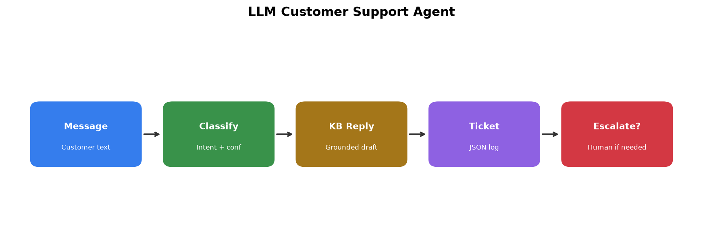
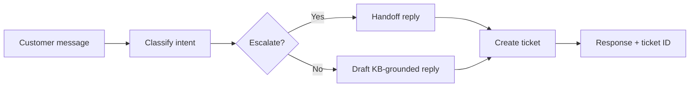
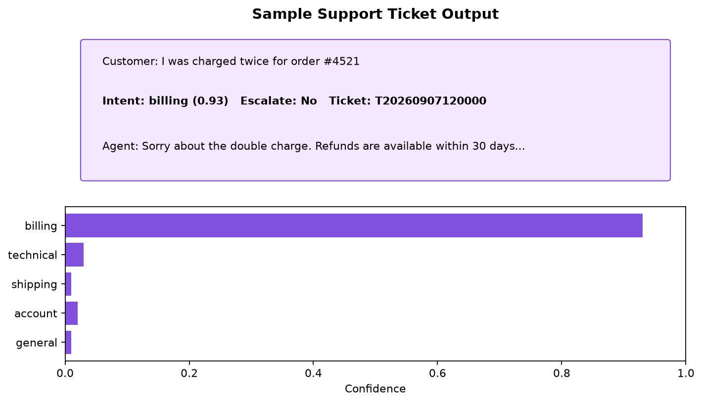

# NovaMart LLM Customer Support Agent

[](https://www.python.org/downloads/)
[](LICENSE)
[](https://langchain-ai.github.io/langgraph/)

An AI customer-support agent that **classifies intent**, **grounds replies in a JSON knowledge base**, **logs tickets**, and **escalates** low-confidence or sensitive cases — built with LangChain, LangGraph, and OpenAI.



## Features

| Capability | Detail |
|---|---|
| Intent routing | `billing`, `technical`, `shipping`, `account`, `escalate`, `general` via structured LLM output |
| Grounded replies | Answers are constrained to facts in `knowledge_base.json` |
| Ticket logging | Every interaction is saved as JSON under `tickets/` |
| Smart escalation | Auto-handoff when confidence &lt; threshold or intent is `escalate` |
| Dual interfaces | CLI REPL + Streamlit demo UI |
| Configurable | Model, temperatures, and escalate threshold via `.env` |

## Architecture



**Why LangGraph?** The pipeline is an explicit state machine (`classify → reply → ticket`), which makes routing, escalation, and logging easy to inspect and extend compared to a single prompt chain.

## Quick start

```bash
cd llm-customer-support-agent
python -m venv .venv

# Windows
.venv\Scripts\activate

# macOS / Linux
source .venv/bin/activate

pip install -r requirements.txt
copy .env.example .env   # then set GROQ_API_KEY (free: https://console.groq.com/keys)
```

> **Free by default:** uses [Groq](https://console.groq.com) (`LLM_PROVIDER=groq`). No OpenAI paid credits needed. Set `LLM_PROVIDER=openai` only if you want OpenAI instead.


### CLI

```bash
python support_agent.py
```

```
Customer> I was charged twice for order #4521
Intent: billing (0.93)
Escalate: False | Ticket: T20261022120000
Agent> ...
```

### Streamlit UI

```bash
streamlit run app.py
```



## Project layout

```
├── app.py                 # Streamlit demo UI
├── support_agent.py       # LangGraph agent (classify → reply → ticket)
├── config.py              # Env-driven settings
├── knowledge_base.json    # NovaMart policy facts
├── tests/                 # Pytest suite (mocked LLM)
├── outputs/               # Demo screenshots
├── tickets/               # Runtime ticket logs (gitignored)
├── .env.example
├── requirements.txt
└── requirements-dev.txt
```

## Configuration

| Variable | Default | Description |
|---|---|---|
| `LLM_PROVIDER` | `groq` | `groq` (free) or `openai` |
| `GROQ_API_KEY` | — | Required for Groq — free at console.groq.com |
| `GROQ_MODEL` | `openai/gpt-oss-20b` | Groq chat model (free-tier) |
| `OPENAI_API_KEY` | — | Only if `LLM_PROVIDER=openai` |
| `OPENAI_MODEL` | `gpt-4o-mini` | OpenAI chat model |
| `CLASSIFY_TEMPERATURE` | `0` | Intent classification temperature |
| `REPLY_TEMPERATURE` | `0.3` | Reply drafting temperature |
| `ESCALATE_THRESHOLD` | `0.45` | Confidence below this triggers handoff |
| `COMPANY_NAME` | `NovaMart` | Branding in UI and escalation copy |

## Extending the knowledge base

Edit `knowledge_base.json` — add or update fields under the relevant intent. The draft step injects that section into the prompt and instructs the model **not to invent policies**.

## Tests

```bash
pip install -r requirements-dev.txt
pytest -q
```

Tests mock the LLM so they run without an API key.

## Deploy (Streamlit Community Cloud — free)

1. Push this repo to GitHub (branch `main`).
2. Go to [share.streamlit.io](https://share.streamlit.io) → **New app**.
3. Select repo `llm-customer-support-agent`, branch `main`, main file `app.py`.
4. Under **Advanced settings → Secrets**, paste:

```toml
LLM_PROVIDER = "groq"
GROQ_API_KEY = "gsk_your-real-key"
GROQ_MODEL = "openai/gpt-oss-20b"
```

5. Click **Deploy**. Your public URL will look like `https://<app-name>.streamlit.app`.

Never commit `.env` or `.streamlit/secrets.toml` — keys stay in Streamlit Secrets only.

## Troubleshooting

| Issue | Fix |
|---|---|
| `GROQ_API_KEY is missing` | Copy `.env.example` → `.env` and add a free key from console.groq.com |
| Rate limit / API errors | Shown in the UI; wait a minute or check Groq usage limits |
| Empty / vague answers | Expand the matching section in `knowledge_base.json` |

## License

MIT — see [LICENSE](LICENSE).
